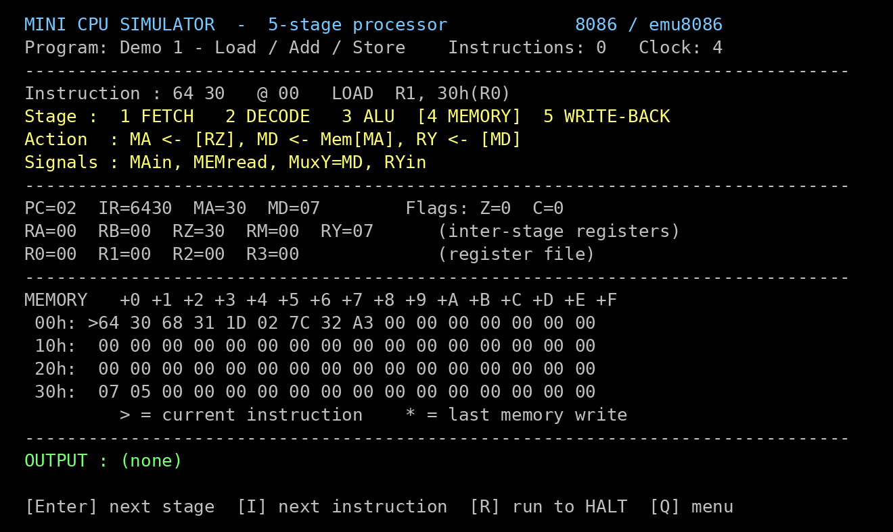
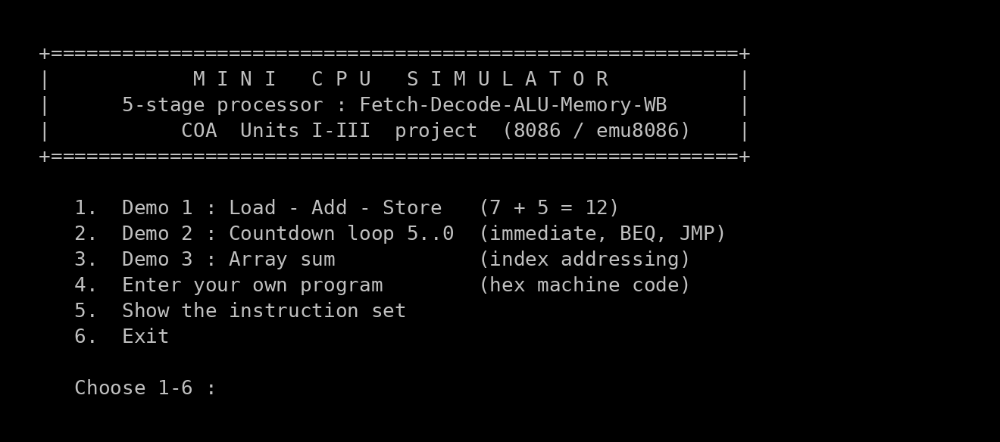
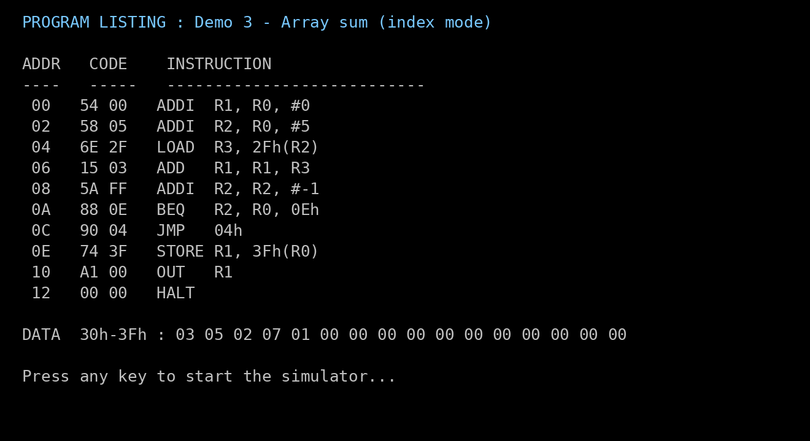
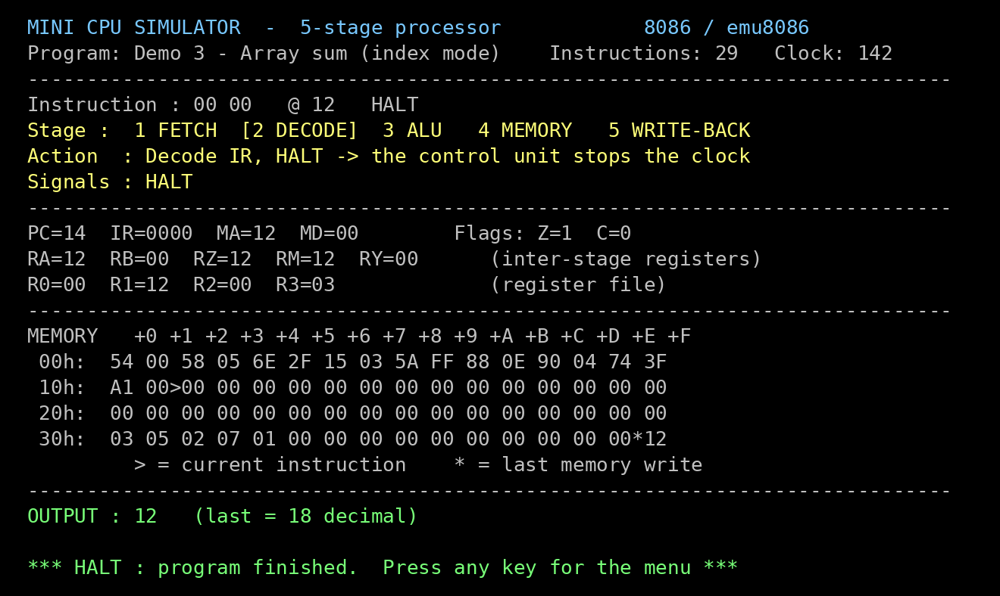
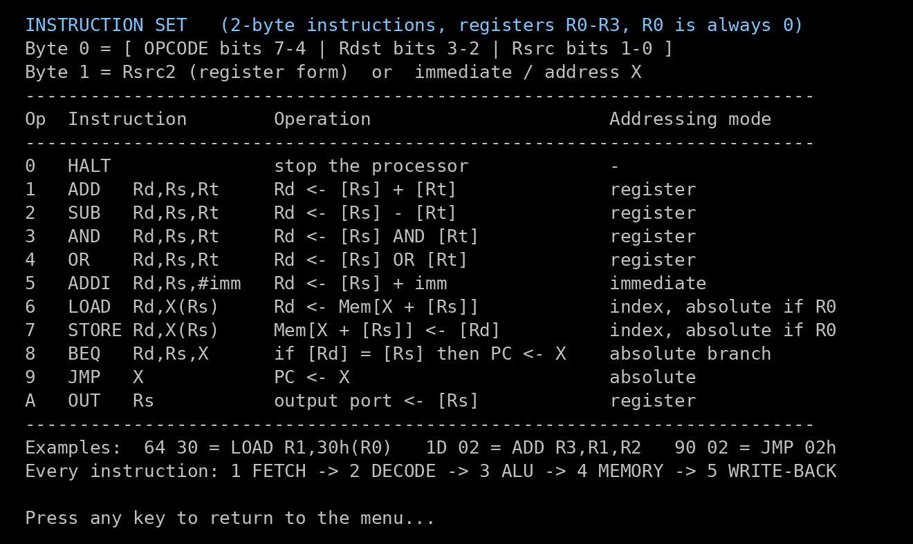

# Mini CPU Simulator : 5-Stage Processor in 8086 Assembly

A small 8-bit processor simulated **in 8086 assembly**, built to run in **emu8086**.
Each key press runs one clock cycle (one stage) of the current instruction. The screen shows:

- the register-transfer (RTL) action of that stage
- the control signals that are active
- the processor registers (PC, IR, MA, MD)
- the inter-stage registers (RA, RB, RZ, RM, RY)
- the register file (R0 to R3), the flags (Z, C) and all 64 bytes of memory

The design follows the *Execution of a Complete Instruction* model from the
**Computer Organization & System Architecture** course (Unit II, Hamacher et al.):

```
 1 FETCH  ->  2 DECODE  ->  3 ALU  ->  4 MEMORY  ->  5 WRITE-BACK
```



---

## Syllabus coverage

| Unit | Topic | Where it shows up in the simulator |
|---|---|---|
| I | Functional units of a computer | Memory, ALU, control unit, register file and output port, all shown on one screen |
| I | Bus structures | MA/MD registers hold the memory address and data for each transfer |
| I | Instruction formats | 16-bit instructions in R-format (`Rd,Rs,Rt`) and I-format (`Rd,Rs,#imm` / `X(Rs)`) |
| I | Addressing modes | Register, immediate, absolute, and index `X(Rs)` |
| I | 8086 architecture & assembly programming | The whole simulator is written in 8086 assembly (INT 21h, INT 10h, INT 16h) |
| I | ALU design | ADD, SUB, AND, OR with Z and C flags |
| II | Execution of a complete instruction | Every instruction goes through the 5 stages, one stage per key press |
| II | Hardwired control | Each stage asserts a fixed set of control signals (`PCout, MAin, MEMread, ...`) |
| II | RISC principles | Fixed-length instructions, load/store architecture, register-to-register ALU ops |
| III | Pipeline basics | The 5 stages are the stages of a classic pipeline; RA/RB/RZ/RM/RY are the inter-stage buffers |

---

## Running it in emu8086

1. Open **emu8086** and choose **File > Open**, then select `src/MINICPU.ASM`.
2. Click **Compile** (or press `F5`, which compiles and starts the emulator).
3. In the emulator window, click **Run**. Set the speed slider to the fastest setting so the screen redraws instantly.
4. The program's output appears in the **emulator screen** window. Click that window before you press keys.

| Key | Action |
|---|---|
| `1` `2` `3` | Load a demo program |
| `4` | Type your own machine code in hex |
| `5` | Show the instruction set |
| `Enter` / `Space` | Run the **next stage** (one clock cycle) |
| `I` | Run until the current **instruction** completes |
| `R` | **Run** the whole program up to `HALT` |
| `Q` / `Esc` | Back to the menu |
| `6` | Exit |

The program is a `.COM` file (`org 100h`). It uses only BIOS and DOS services that emu8086 supports:
INT 21h functions 02h, 09h and 4Ch, INT 10h function 00h, and INT 16h function 00h.

---

## The simulated machine

| Item | Value |
|---|---|
| Word size | 8 bits |
| Memory | 64 bytes, addresses `00h` to `3Fh` (data area by convention `30h` to `3Fh`) |
| Registers | `R0` to `R3`. **R0 is hard-wired to 0**, so `X(R0)` gives absolute addressing |
| Processor registers | `PC`, `IR` (2 bytes), `MA`, `MD` |
| Inter-stage registers | `RA`, `RB` (ALU inputs), `RZ` (ALU output), `RM` (store data), `RY` (write-back data) |
| Flags | `Z` (zero), `C` (carry/borrow) |
| Instruction length | 2 bytes. `PC <- PC + 2` on every fetch |

### Instruction format

```
 Byte 0:  | OPCODE (7-4) | Rdst (3-2) | Rsrc (1-0) |
 Byte 1:  | Rsrc2 (R-format)  or  immediate / address X (I-format) |
```

### Instruction set

| Op | Instruction | Operation | Addressing mode |
|---|---|---|---|
| 0 | `HALT` | stop the processor | - |
| 1 | `ADD Rd, Rs, Rt` | `Rd <- [Rs] + [Rt]` | register |
| 2 | `SUB Rd, Rs, Rt` | `Rd <- [Rs] - [Rt]` | register |
| 3 | `AND Rd, Rs, Rt` | `Rd <- [Rs] AND [Rt]` | register |
| 4 | `OR Rd, Rs, Rt` | `Rd <- [Rs] OR [Rt]` | register |
| 5 | `ADDI Rd, Rs, #imm` | `Rd <- [Rs] + imm` | immediate |
| 6 | `LOAD Rd, X(Rs)` | `Rd <- Mem[X + [Rs]]` | index (absolute if Rs = R0) |
| 7 | `STORE Rd, X(Rs)` | `Mem[X + [Rs]] <- [Rd]` | index (absolute if Rs = R0) |
| 8 | `BEQ Rd, Rs, X` | `if [Rd] = [Rs] then PC <- X` | absolute branch |
| 9 | `JMP X` | `PC <- X` | absolute |
| A | `OUT Rs` | `output port <- [Rs]` | register |

**Hand-assembling an instruction.** `LOAD R1, 30h(R0)`: opcode `6` = `0110`, Rd = R1 = `01`, Rs = R0 = `00`.
Byte 0 = `0110 01 00` = `64h`, and byte 1 = X = `30h`. The machine code is **`64 30`**.

For a negative immediate, use two's complement: `ADDI R1, R1, #-1` = **`55 FF`**.

See [`docs/STAGE_TABLES.md`](docs/STAGE_TABLES.md) for what every instruction does in each of the five stages.

---

## Demo programs

### Demo 1 : Load, Add, Store (7 + 5 = 12)
Uses the same three instruction types as the slides (Load, Add, Store).
```
00  64 30   LOAD  R1, 30h(R0)     R1 <- Mem[30h] = 07
02  68 31   LOAD  R2, 31h(R0)     R2 <- Mem[31h] = 05
04  1D 02   ADD   R3, R1, R2      R3 <- 0Ch
06  7C 32   STORE R3, 32h(R0)     Mem[32h] <- 0Ch
08  A3 00   OUT   R3              output 0C (12)
0A  00 00   HALT
```

### Demo 2 : Countdown loop (immediate mode, BEQ, JMP)
```
00  54 05   ADDI  R1, R0, #5      R1 <- 5
02  A1 00   OUT   R1              loop: print R1
04  55 FF   ADDI  R1, R1, #-1     R1 <- R1 - 1
06  84 0A   BEQ   R1, R0, 0Ah     if R1 = 0 goto done
08  90 02   JMP   02h             goto loop
0A  A1 00   OUT   R1              done
0C  00 00   HALT
```
Output: `05 04 03 02 01 00`

### Demo 3 : Array sum (index addressing)
```
00  54 00   ADDI  R1, R0, #0      sum = 0
02  58 05   ADDI  R2, R0, #5      i = 5
04  6E 2F   LOAD  R3, 2Fh(R2)     loop: R3 <- Mem[2Fh + i]
06  15 03   ADD   R1, R1, R3      sum += R3
08  5A FF   ADDI  R2, R2, #-1     i--
0A  88 0E   BEQ   R2, R0, 0Eh     if i = 0 goto done
0C  90 04   JMP   04h
0E  74 3F   STORE R1, 3Fh(R0)     done: Mem[3Fh] <- sum
10  A1 00   OUT   R1
12  00 00   HALT
30h..34h = 03 05 02 07 01
```
Output: `12` (hex) = 18

### Your own program
Choose `4`, then type 2 hex digits per byte, starting at address `00h`. Type `.` to finish; every remaining byte is set to `00`.
Invalid keys beep and are ignored.

---

## Screenshots

| Menu | Program listing |
|---|---|
|  |  |

| Demo 3 finished | Instruction set |
|---|---|
|  |  |

> These images were rendered by the automated test harness, which shows the same text that emu8086 displays.
> You can replace them with real emu8086 screenshots.

---

## Project structure

```
mini-cpu-simulator/
├── src/
│   └── MINICPU.ASM          the simulator (open this in emu8086)
├── docs/
│   ├── STAGE_TABLES.md      5-stage RTL + control signals for every instruction
│   └── DEMO_GUIDE.md        how to present the project, step by step
├── tests/
│   ├── dosemu.py            8086 test harness (NASM `cpu 8086` + Unicorn emulator)
│   ├── test_minicpu.py      30 automated checks
│   └── screenshots.py       regenerates the screenshots
├── screenshots/
└── README.md
```

## Automated tests (optional)

The tests convert the emu8086 source to NASM syntax and assemble it with `cpu 8086`, so the build fails on any instruction a real 8086 cannot run.
They then run the program in the Unicorn CPU emulator with a simulated DOS screen and keyboard.

```bash
sudo apt install nasm
pip install unicorn pillow
cd tests && python3 test_minicpu.py
```

The tests check the following:
- each demo's output, final registers and memory
- each of the five stages of `LOAD`
- branch taken and branch not taken
- custom program entry
- illegal opcode handling
- the infinite-loop guard
- that writes to R0 are ignored
- that every screen fits in 80 columns

## Author

**Lakshay**, B.Tech CSE (AI/ML), SRM University AP.
Course: Computer Organization & System Architecture.

## License

MIT
