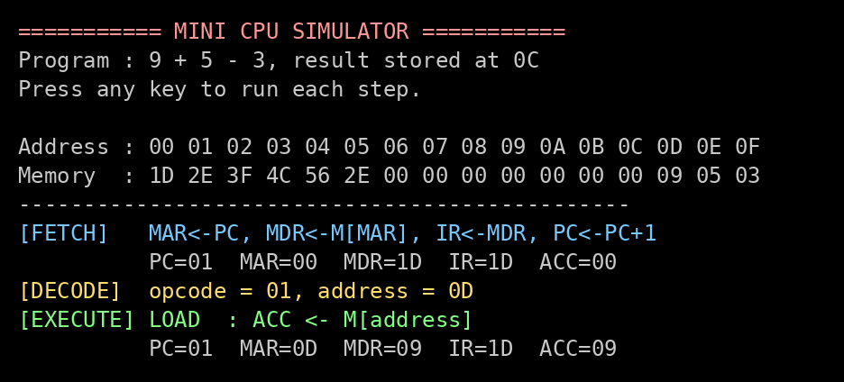
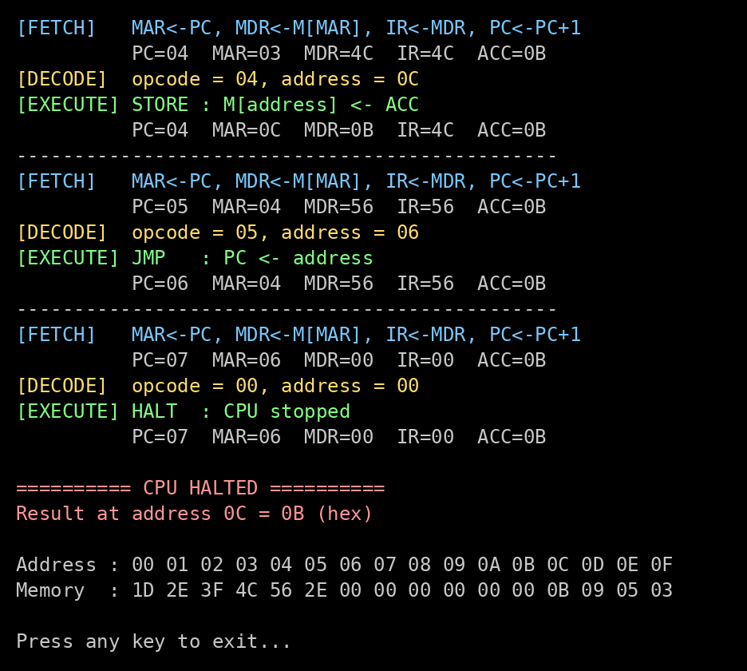

# Mini CPU Simulator (8086 Assembly / emu8086)

A simple CPU simulator written in **8086 assembly language** that runs in **emu8086**.

It simulates a small CPU and shows the **Fetch → Decode → Execute** cycle one step at a time.
Each key press runs one step, and the screen shows how the registers **PC, MAR, MDR, IR and ACC** change.



---

## The simulated CPU

| Part | Details |
|---|---|
| Registers | **PC** (Program Counter), **MAR** (Memory Address Register), **MDR** (Memory Data Register), **IR** (Instruction Register), **ACC** (Accumulator) |
| Memory | 16 bytes, addresses `00` to `0F` |
| Instruction size | 1 byte: **high 4 bits = opcode**, **low 4 bits = address** |

Example: `2E` means opcode **2** (ADD) and address **E**, so it is `ADD 0E`.

### Instruction set

| Opcode | Instruction | Meaning |
|---|---|---|
| 1 | `LOAD addr` | ACC ← M[addr] |
| 2 | `ADD addr` | ACC ← ACC + M[addr] |
| 3 | `SUB addr` | ACC ← ACC − M[addr] |
| 4 | `STORE addr` | M[addr] ← ACC |
| 5 | `JMP addr` | PC ← addr |
| 0 | `HALT` | stop the CPU |

### The instruction cycle

| Step | What happens |
|---|---|
| **FETCH** | MAR ← PC, MDR ← M[MAR], IR ← MDR, PC ← PC + 1 |
| **DECODE** | opcode = high 4 bits of IR, address = low 4 bits of IR |
| **EXECUTE** | perform LOAD / ADD / SUB / STORE / JMP / HALT |

---

## The program stored in memory

The program calculates **9 + 5 − 3 = 11** and stores the result at address `0C`.

| Address | Code | Instruction | Result |
|---|---|---|---|
| 00 | `1D` | LOAD 0D | ACC = 9 |
| 01 | `2E` | ADD 0E | ACC = 9 + 5 = 14 |
| 02 | `3F` | SUB 0F | ACC = 14 − 3 = 11 |
| 03 | `4C` | STORE 0C | M[0C] = 11 (`0B` in hex) |
| 04 | `56` | JMP 06 | jumps over address 05 |
| 05 | `2E` | ADD 0E | skipped |
| 06 | `00` | HALT | CPU stops |
| 0D, 0E, 0F | `09` `05` `03` | data | the numbers 9, 5 and 3 |

Final output:



To run a different calculation, change the numbers in the `ram` line of `src/MINICPU.ASM` and run the program again.

---

## How to run

See the **[how to execute](how%20to%20execute/)** folder:

- **README / HOW_TO_EXECUTE.pdf** : running the project in emu8086 and demonstrating it
- **CODE_EXPLANATION / CODE_EXPLANATION.pdf** : line-by-line explanation of the code

In short:
1. Open `src/MINICPU.ASM` in emu8086.
2. Click **Emulate**, then **Run**.
3. Press any key to go through each step.

---

## Project files

```
Mini-CPU-Simulator/
├── src/MINICPU.ASM      the program (open this in emu8086)
├── how to execute/      how to run, demonstrate and explain the code (with PDFs)
├── screenshots/         output screenshots
└── tests/               optional automated tests (Python)
```

## Author

**Lakshay**, B.Tech CSE (AI/ML), SRM University AP
Course: Computer Organization & System Architecture

## License

MIT
